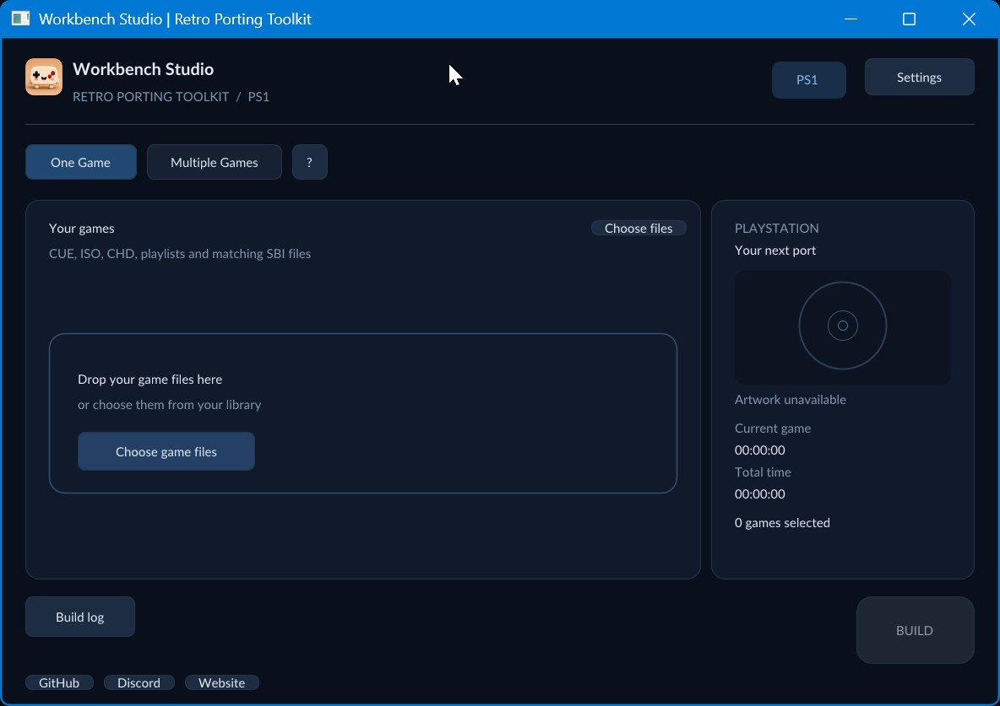

# Workbench Studio

A compact Windows interface for PlayStation recompilation. Configure BIOS files and an output folder, choose discs or playlists, then build. This edition keeps its own settings and caches.



Download [the Windows preview ZIP](dist/WorkbenchStudio-Windows-preview.zip) and its [SHA-256 checksum](dist/WorkbenchStudio-Windows-preview.zip.sha256), extract the complete folder, and open `Workbench Studio.cmd`. Git for Windows must be on PATH. The included Python runtime needs no separate installation. See [Quickstart](docs/QUICKSTART.txt).

The main screen supports one game or a batch. Multi-disc games stay grouped by playlist. Matching SBI files can be selected with discs. Completed games appear directly in the chosen output folder. Completed cards are blue, failed cards red; current-game and total timers remain separate. Cancelling stops the current process tree and queued work.

Settings holds BIOS files, output location, source versions and Advanced options: portable output, fast boot, compiler optimization, LTO, PGO, diagnostics and optional startup checks. Startup checks are off by default. Source and compiler payloads are obtained only after Build. Optional artwork can be fetched when a game is detected.

The included supported core version is fetched from its public repository. The matching launcher build sources, module and SDL are included with checksums and licence notices. That launcher revision is supplied locally rather than fetched from an unavailable remote revision. See [version identities](docs/VERSIONS.json) and [dependency inputs](DEPENDENCIES.json).

This is a Windows preview. The supported version pair completed a real game build and bounded headless startup. A separate modern local-source pair also completed a portable build and a bounded recording/playback check. Arbitrary online source versions and Linux remain unqualified; Advanced source-only builds also need PowerShell 7 (`pwsh`). See [validation limits](docs/VALIDATION.md).

Thin outputs depend on the persistent compiler cache under `%LOCALAPPDATA%\RPT\compilers`; keep it while using those games. Portable outputs include their compiler and selected media. Neither this repository nor its downloadable Studio archive contains game discs, BIOS images, saves or personal settings.

## Source layout

- `src/`: Python build controller, assets, supported version records and licensed launcher inputs.
- `native/`: SDL3/Dear ImGui frontend and process runner.
- `scripts/`: local frontend build and distribution packaging.
- `dist/`: the checked Windows preview ZIP and checksum, without an unpacked runtime tree.
- `docs/`: quickstart, version identities and validation limits.

## Build the frontend

Use Windows, PowerShell 7 and an existing local `cmake-clang-v1` 1.0.14 Windows SDK. Its archive identity is recorded in `src/toolchain-pin.toml`. No global SDK activation is needed.

```powershell
& .\scripts\build.ps1 -ToolchainRoot '.\.tools\cmake-clang-v1\1.0.14'
python .\scripts\package.py
```

The build expands the included launcher source for the exact ImGui/STB files. Packaging reuses the hash-checked CPython runtime from the committed distribution and combines it with `src/` and the rebuilt frontend. Python 3.11 or later runs the packaging script; the shipped application runtime remains CPython 3.14.3. Output goes under `build/package/`, leaving the checked archive unchanged. The build recipe is provided for maintenance; no byte-for-byte reproducibility claim is made for newly compiled binaries.

## Build workflow and releases

The primary organisation repository runs [Windows build](.github/workflows/windows.yml) on main pushes, pull requests and manual dispatch. It checks the pinned SDK hash, runs media-free controller/batch/delivery tests, rebuilds the native frontend, packages Studio, checks the extracted inventory and bundled runtime, then uploads the ZIP, checksum and verification record. Two optional upstream-source fixture tests skip when their separate source trees are absent. A pinned software OpenGL fixture lets the hosted Windows runner render the actual hidden frontend. It is confined to the extracted test copy and is never included in the distribution.

The personal mirror keeps the same source; automatic builds run in the primary organisation repository. Workflow artifacts need a signed-in repository reader. Releases are prepared as drafts for manual publication; no workflow publishes them automatically.

The project uses the [PolyForm Noncommercial licence](LICENSE). Third-party notices remain in `src/licenses`, `src/assets/licenses` and the included launcher source archive.
